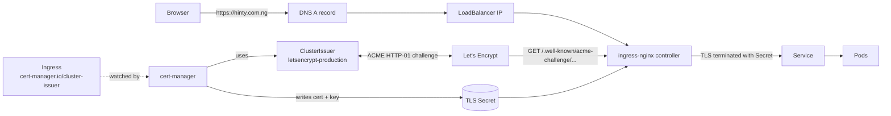
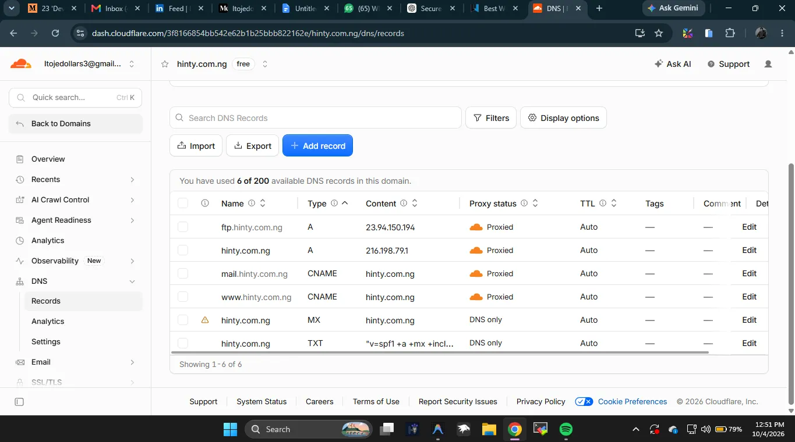
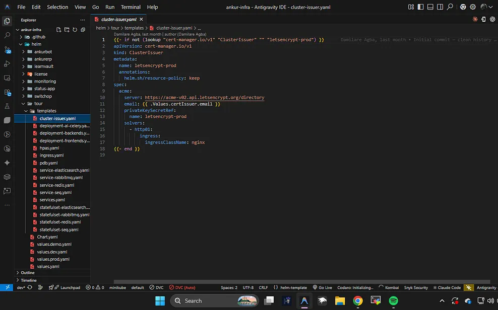
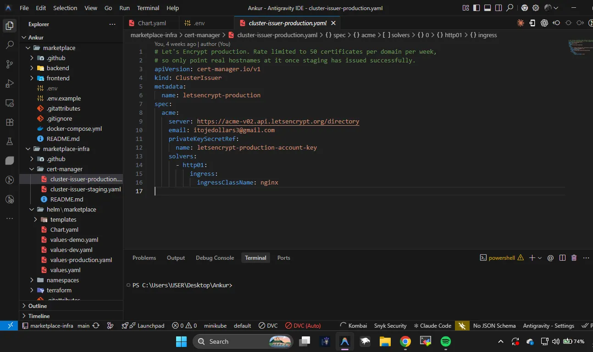
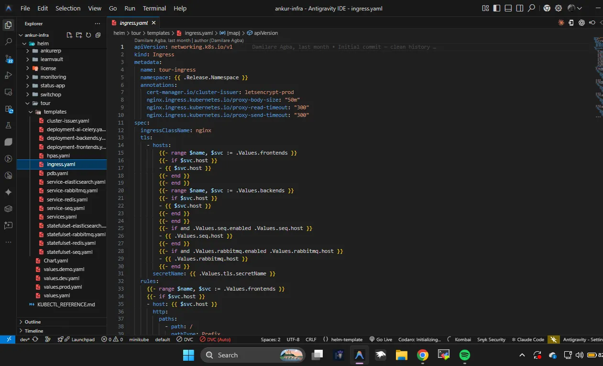
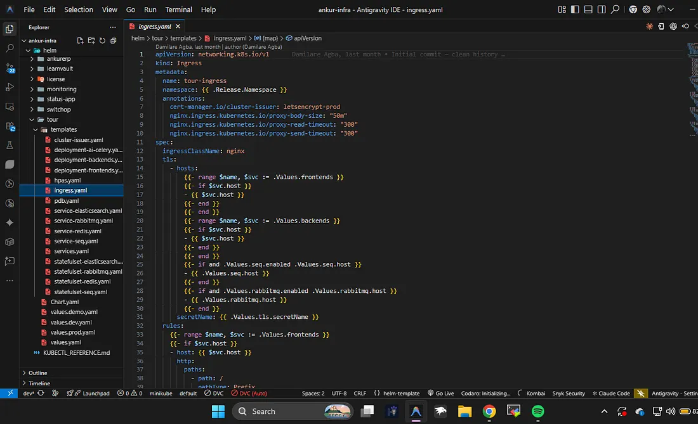

# Kubernetes Ingress NGINX + TLS/SSL with Let's Encrypt, cert-manager & ClusterIssuer


A Helm chart that exposes an app through **ingress-nginx** and gets a free, auto-renewing **TLS certificate from Let's Encrypt** using **cert-manager** and a **ClusterIssuer**.

You install the chart, point DNS at the cluster, and get HTTPS. Certificates renew automatically before they expire.

---

## Table of contents

- [How it works](#how-it-works)
- [Repository layout](#repository-layout)
- [Prerequisites](#prerequisites)
- [Quick start](#quick-start)
- [The ClusterIssuer](#the-clusterissuer)
- [The Ingress and TLS](#the-ingress-and-tls)
- [Configuration](#configuration)
- [Verify](#verify)
- [Troubleshooting](#troubleshooting)
- [Uninstall](#uninstall)

---

## How it works



1. The **Ingress** has the annotation `cert-manager.io/cluster-issuer: letsencrypt-<env>` and a `tls` block that lists the hosts and a `secretName`.
2. **cert-manager** sees the annotation and creates a `Certificate` → `CertificateRequest` → ACME `Order` → `Challenge`.
3. For the **HTTP-01** challenge, cert-manager adds a temporary solver Ingress. Let's Encrypt then requests `http://<host>/.well-known/acme-challenge/<token>` through ingress-nginx.
4. Once the challenge passes, the signed certificate is stored in the TLS **Secret**. ingress-nginx serves it on port 443.
5. cert-manager renews the certificate about 30 days before it expires.

---

## Repository layout

```
.
├── charts/tls-ingress/          # Helm chart
│   ├── Chart.yaml
│   ├── values.yaml              # defaults
│   ├── values-staging.yaml      # Let's Encrypt staging (test first)
│   ├── values-production.yaml   # Let's Encrypt production (trusted certs)
│   └── templates/
│       ├── cluster-issuer.yaml  # staging + production ClusterIssuers
│       ├── ingress.yaml         # Ingress with TLS
│       ├── deployment.yaml      # optional demo backend
│       ├── service.yaml
│       ├── _helpers.tpl
│       └── NOTES.txt
├── manifests/                   # same ClusterIssuers as plain YAML (no Helm)
└── docs/images/
```

---

## Prerequisites

- A Kubernetes cluster that can provision a `LoadBalancer` service (EKS, GKE, AKS, DigitalOcean, etc.). On minikube, run `minikube tunnel`.
- `kubectl` and `helm` v3.
- A domain you control (this guide uses `hinty.com.ng` on Cloudflare).

### 1. Install ingress-nginx

```bash
helm repo add ingress-nginx https://kubernetes.github.io/ingress-nginx
helm repo update

helm upgrade --install ingress-nginx ingress-nginx/ingress-nginx \
  --namespace ingress-nginx --create-namespace

kubectl get svc -n ingress-nginx ingress-nginx-controller
```

Copy the `EXTERNAL-IP`. You need it for DNS.

### 2. Install cert-manager

```bash
helm repo add jetstack https://charts.jetstack.io
helm repo update

helm upgrade --install cert-manager jetstack/cert-manager \
  --namespace cert-manager --create-namespace \
  --set crds.enabled=true

kubectl get pods -n cert-manager
```

### 3. Point DNS at the ingress controller

Create an `A` record for each host. It should point to the ingress controller's `EXTERNAL-IP`.



> **Cloudflare users:** HTTP-01 has to reach your cluster on port 80. While the first certificate is being issued, either set the record to **DNS only** (grey cloud) or make sure **Always Use HTTPS** is off. Once the cert is issued you can turn the proxy back on and set SSL/TLS mode to **Full (strict)**.

Check that DNS resolves:

```bash
dig +short hinty.com.ng
```

---

## Quick start

Clone the repo:

```bash
git clone https://github.com/dollarsmoney/Kubernetes-Ingress-Controller-NGINX-TLS-SSL-Let-s-Encrypt-cert-manager-and-ClusterIssuer.git
cd Kubernetes-Ingress-Controller-NGINX-TLS-SSL-Let-s-Encrypt-cert-manager-and-ClusterIssuer
```

**Step 1: test with staging.** Staging has generous rate limits, but its certificates are not browser-trusted.

```bash
helm upgrade --install web charts/tls-ingress \
  --namespace web --create-namespace \
  -f charts/tls-ingress/values-staging.yaml \
  --set certIssuer.email=you@example.com
```

**Step 2: switch to production** after the staging certificate shows `READY=True`.

```bash
kubectl delete secret hinty-staging-tls -n web

helm upgrade --install web charts/tls-ingress \
  --namespace web \
  -f charts/tls-ingress/values-production.yaml \
  --set certIssuer.email=you@example.com
```

> Let's Encrypt production allows **50 certificates per registered domain per week**. Always get staging working first.

**Without Helm**, apply the plain issuers and add the annotation to your own Ingress:

```bash
kubectl apply -f manifests/
```

---

## The ClusterIssuer

A `ClusterIssuer` is cluster-scoped, so any namespace can use it. The chart creates two of them: `letsencrypt-staging` and `letsencrypt-production`.



Two details make it safe to install the chart more than once:

- **`lookup` guard.** `{{- if not (lookup "cert-manager.io/v1" "ClusterIssuer" "" "letsencrypt-production") }}` skips creating the issuer if it already exists. A second release then won't fail with *"resource already exists"*.
- **`helm.sh/resource-policy: keep`.** Uninstalling one release doesn't delete the issuer that other releases depend on.

The plain-YAML equivalent ([`manifests/cluster-issuer-production.yaml`](manifests/cluster-issuer-production.yaml)):



| Field | Meaning |
|---|---|
| `server` | ACME endpoint: staging or production |
| `email` | Let's Encrypt sends expiry and problem notices here |
| `privateKeySecretRef` | Secret that holds your ACME account key (cert-manager creates it) |
| `solvers.http01.ingress.ingressClassName` | Which ingress controller serves the challenge |

---

## The Ingress and TLS

The Ingress needs two things:

1. The annotation `cert-manager.io/cluster-issuer: <issuer>`.
2. A `tls:` block with every host and a `secretName`. cert-manager writes the certificate into that Secret.



The TLS host list is built by looping over the same values that generate the routing rules. This way every routed host is also on the certificate:



This chart uses the same pattern, driven by a single `ingress.hosts` list:

```yaml
ingress:
  hosts:
    - host: hinty.com.ng
      paths:
        - path: /
          pathType: Prefix
    - host: api.hinty.com.ng
      paths:
        - path: /
          pathType: Prefix
          service: my-api
          port: 8080
```

---

## Configuration

| Key | Default | Description |
|---|---|---|
| `certIssuer.create` | `true` | Create the staging + production ClusterIssuers |
| `certIssuer.email` | `you@example.com` | ACME registration email (**set this**) |
| `certIssuer.environment` | `staging` | `staging` or `production`; picks the issuer the Ingress uses |
| `certIssuer.ingressClassName` | `nginx` | Ingress class for HTTP-01 solving |
| `ingress.enabled` | `true` | Render the Ingress |
| `ingress.className` | `nginx` | `spec.ingressClassName` |
| `ingress.annotations` | ssl-redirect, body-size | Extra annotations |
| `ingress.hosts[].host` | `app.example.com` | Hostname |
| `ingress.hosts[].paths[].service` | chart's demo service | Backend service name |
| `ingress.hosts[].paths[].port` | `80` | Backend service port |
| `tls.enabled` | `true` | Add the `tls:` block |
| `tls.secretName` | `tls-ingress-cert` | Secret where the certificate is stored |
| `demo.enabled` | `true` | Deploy a small hello-world backend |
| `demo.image` | `nginxdemos/hello:plain-text` | Demo image |

To route to your own app, set `demo.enabled=false` and give each path a `service` and `port`.

---

## Verify

```bash
kubectl get clusterissuer
kubectl get certificate,certificaterequest,order,challenge -n web
kubectl describe certificate hinty-production-tls -n web

curl -v https://hinty.com.ng 2>&1 | grep -E "issuer|subject|expire"
```

When it's working, `READY` is `True` and the issuer is `Let's Encrypt` (production) or `(STAGING)`.

---

## Troubleshooting

| Symptom | Fix |
|---|---|
| `Challenge` stuck in `pending` | DNS doesn't point to the ingress IP yet, or port 80 is blocked. Check `kubectl describe challenge -n web`. |
| `404` on `/.well-known/acme-challenge/...` | `certIssuer.ingressClassName` doesn't match your controller class. Check `kubectl get ingressclass`. |
| Redirect loop / challenge fails behind Cloudflare | Use **DNS only** during issuance, or turn off **Always Use HTTPS**. |
| Browser warns "not secure" | You're still on the staging issuer. Switch to `values-production.yaml` and delete the old secret. |
| `too many certificates already issued` | You hit the production rate limit. Wait, and use staging for testing. |
| `ClusterIssuer ... exists and cannot be imported` | Another release or a `kubectl apply` already created it. The `lookup` guard skips it on install; on an upgrade, set `certIssuer.create=false`. |
| Issuer not ready | `kubectl describe clusterissuer letsencrypt-production` usually means the email is invalid or there's no egress to acme-v02.api.letsencrypt.org. |

---

## Uninstall

```bash
helm uninstall web -n web
kubectl delete secret hinty-production-tls -n web
```

The ClusterIssuers stay in the cluster because of `helm.sh/resource-policy: keep`. To remove them:

```bash
kubectl delete clusterissuer letsencrypt-staging letsencrypt-production
```
